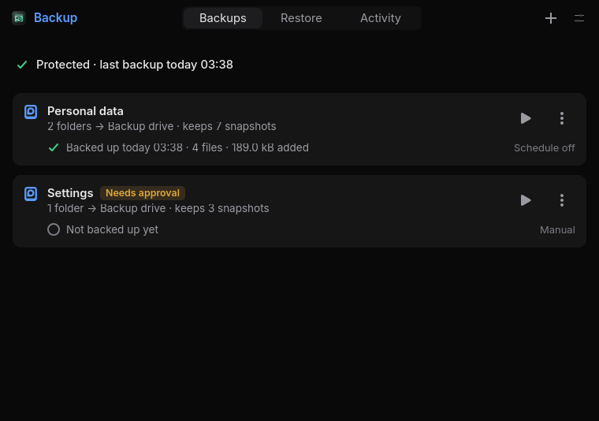

# Nyx Backup

A Rust/GTK4 desktop app for encrypted Restic backups of **selected user data and readable system metadata**. Standard Restic tools can read its repositories. The desktop app is unprivileged; broad complete-system, physical-machine and cross-PC recovery remain unqualified. Phase 2 adds staged selective restoration, dotfile diffs, conflict handling and rollback. Phase 3 adds package inventories, reviewed user/hardware migration planning and a versioned Setup consumer. Phase 4 adds a separate offline whole-disk recovery helper and bootable recovery kit, qualified against a disposable UEFI VM. Version 0.6.0 adds S3-compatible cloud destinations, explicit private-GitHub Backup settings sync and granted Control Center integration, with local security/failure/performance qualification.

The window is a compact floating Nyx 2.0 window (760 × 560; the installer adds the Hyprland rule) with three views switched in the header: **Backups** (one card per profile with its last result, schedule, progress and actions, plus a setup checklist until the first backup), **Restore** (snapshots, an in-window file browser and reviewed restore plans, receipts and rollback) and **Activity** (every job and its details). Destinations, notifications and integrations live in the Settings card (Ctrl+,). Backup and repository-administration jobs belong to an on-demand systemd user service, so closing the window does not stop them. Scheduling and retention deletion require explicit action.



## Install and develop

Requires Linux, Rust (2024 edition), GTK4 ≥4.18, Restic, Rclone, `secret-tool`, a session Secret Service, D-Bus and systemd user services. SSH supplies SFTP authentication; NFS mounting requires an administrator's existing user-mountable fstab entry. No privileged desktop service, setuid helper or lingering is installed. Offline disk recovery requires booting its separate root environment.

```sh
cargo build --release --locked --workspace
./install.sh --skip-build
```

Installation includes `nyx-backup`, `nyx-backupctl`, `nyx-backupd` the `nyx-backup-setup` consumer, `nyx-backup-recovery` and its kit builder in `~/.local/bin`, the launcher/icon in XDG data directories, D-Bus activation, and the user service. It does not launch the GUI, enable timers or restart an existing instance. `./install.sh` also builds. Shared dependencies use immutable published revisions.

Headless libraries and CLI/service build with `cargo build --locked` (the default workspace members exclude GTK). The GUI lives in `apps/backup`; domain crates live in `crates/backup-{core,system,engine,restore,migrate,recovery,service}`.

```sh
cargo fmt --all --check
cargo test --locked -p backup-engine -p backup-restore -p backup-migrate -p backup-service -p backup-system -p backup-recovery
# Disposable private-bus/keyring integration test; never selects real user data:
python3 tools/smoke.py
# Private-bus activation and a disposable transient user timer:
python3 tools/service-smoke.py
# Loopback SFTP-only server, private SSH config and disposable data:
python3 tools/sftp-smoke.py
# Full selected-file restore/diff/conflict/rollback qualification:
python3 tools/restore-smoke.py
```

The smoke test requires built release binaries, `gnome-keyring-daemon`, `gdbus`, and native Restic. It retains its private temporary fixture for inspection. See [qualification](docs/QUALIFICATION.md) for evidence and limits.

## First backup

1. Add a destination in Settings. For a mounted drive, choose **Mounted external storage**, which records mount identity and filesystem UUID. A local folder has no removable-device protection.
2. Save the repository password in Secret Service, or generate one for a new repository. For SMB, also save the NAS credential, which creates an encrypted, private Rclone configuration bound to that server/account. After editing those settings, set the SMB credential again to confirm the new target. Older configurations without this binding require the same explicit confirmation.
3. Create a profile, select absolute source paths, review exclusions, and preview. The folder and configuration pickers make selections explicit. Recognized caches, trash, secrets, database/VM stores, Backup's working files and all configured repository destinations are outside defaults. Build folders are retained.
4. Test connectivity, then validate an existing repository **or** explicitly initialize a new repository. Connection failures never trigger initialization.
5. Approve the profile and start a backup. Use snapshot history and verification to inspect results. Export the recovery password explicitly to a new file and keep it separately.

Any file can contain secrets. The recognized-key authorization checkbox permits recognized credential paths; it cannot identify all sensitive data. Active database/VM detection is best effort. Stop applications or select consistent exports. Symlinks are saved as links, not followed. Preview reports logical file bytes, not compressed network transfer size. Unreadable selections produce an incomplete result, not success.

## CLI

CLI output is JSON; `--json` also makes errors machine-readable. Secrets are prompted without echo, or read from stdin with `--stdin`; there are no password arguments. `data/example.toml` documents the profile format.

```sh
nyx-backupctl inventory
nyx-backupctl config import ./my-config.toml
nyx-backupctl password local --generate
nyx-backupctl export-password local /chosen/new/recovery-password.txt
nyx-backupctl destination local test
nyx-backupctl destination local validate personal
# Only for a new repository; never a connection repair:
nyx-backupctl destination local init personal --confirm
nyx-backupctl preview personal
nyx-backupctl approve personal
nyx-backupctl backup personal --wait
nyx-backupctl history personal
nyx-backupctl stats personal
nyx-backupctl verify personal --full --wait
nyx-backupctl status
nyx-backupctl jobs
nyx-backupctl cancel JOB_ID
nyx-backupctl schedule personal --enable
nyx-backupctl schedule personal --disable
nyx-backupctl retention personal
# Review the preview before explicitly deleting snapshots:
nyx-backupctl retention personal --apply --confirm-profile personal
```

`destination ID bind` records the current mount identity for an existing local destination. `destination ID connect` / `disconnect` manages only preconfigured NFS mounts. `smb-password ID` sets NAS credentials. Edit sources, exclusions, schedule and retention in the app or import TOML. `config show`, `profiles`, `destinations`, `job ID`, `schedules` and `capabilities` support automation. A waiting CLI exits nonzero on failed, incomplete, cancelled or interrupted jobs.

Schedules are systemd calendar expressions; a saved calendar alone does not enable a timer. Timers use the same approved-profile service path as manual backups. The user manager must be active and Secret Service accessible; lingering is never enabled. Retention is manual, filters both `nyx-backup` and `profile:ID` tags, keeps at least one snapshot, and does not automatically prune repository data.

## Recovery and limitations

Use the Restore page to browse profile-owned snapshots, select files/folders, prepare a separate-folder restore plan, review diffs and conflicts, and confirm applying it. Quick Dotfiles Restore uses original current-user configuration paths only after explicit review. Existing files are skipped by default; keep-both and replace-with-rollback are available. Restore receipts retain originals and refuse changed rollback targets. See the [full restore workflow and CLI](docs/RESTORE.md).

Native Restic also works with the same repositories and recovery password:

```sh
restic --repo /path/to/repository snapshots
restic --repo /path/to/repository restore SNAPSHOT_ID --target /new/empty/recovery-folder
```

For SMB, use the encrypted Rclone config and its Secret Service password command as documented in [security](docs/SECURITY.md), or configure a standard Rclone SMB remote separately. SFTP uses existing SSH configuration and agent/identity authentication.

Cancellation also interrupts file-source preparation before Restic starts. A cancelled or interrupted backup can be started again incrementally. This reuses stored repository content; it does not resume at an exact byte offset. Backup never removes uncertain Restic locks. Inspect the repository and confirm no worker is using it before using native Restic maintenance tools.

The app restores contents, symlinks, modes and modification times; ownership, ACLs, extended attributes and hard-link topology are not applied. Private staging and recovery copies are retained. Close apps before replacing their configuration.

For reviewed migration and Setup handoff, see [Phase 3 workflow](docs/MIGRATION.md). For explicitly captured offline disk images and boot kits, see [Phase 4 recovery](docs/RECOVERY.md). Selected-data snapshots cannot become whole-disk images retroactively.

See [architecture/API](docs/ARCHITECTURE.md), [security](docs/SECURITY.md), [capabilities and roadmap](docs/ROADMAP.md), and [Restic recovery documentation](https://restic.readthedocs.io/en/stable/050_restore.html).


Cloud, GitHub settings sync and expiring integration grants are described in [the ecosystem workflow](docs/ECOSYSTEM.md). The independent Control Center includes a selectable Backup tile; no panel layout is changed automatically. See [security review](docs/SECURITY-REVIEW.md) for current dependency checks and qualification limits. Version 0.6.1 has zero OSV findings in its locked crates.io graph, authenticated Samba qualification, and dark/light GUI renders with targeted dialog/shortcut checks. Real commercial cloud/GitHub accounts and physical desktop input remain unverified.
